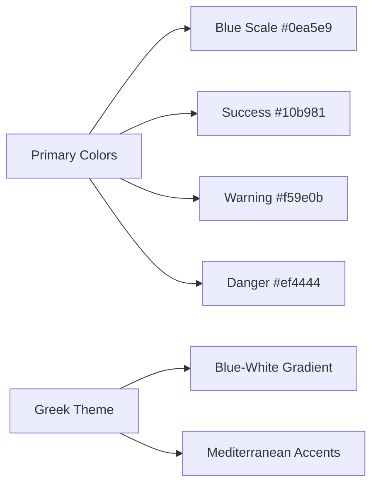
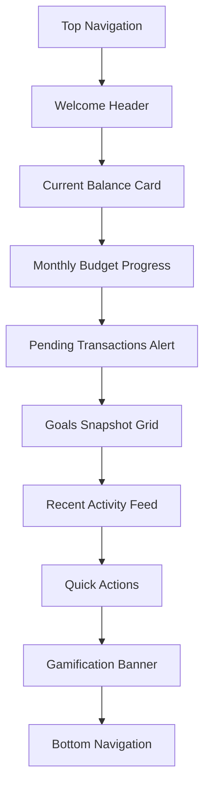
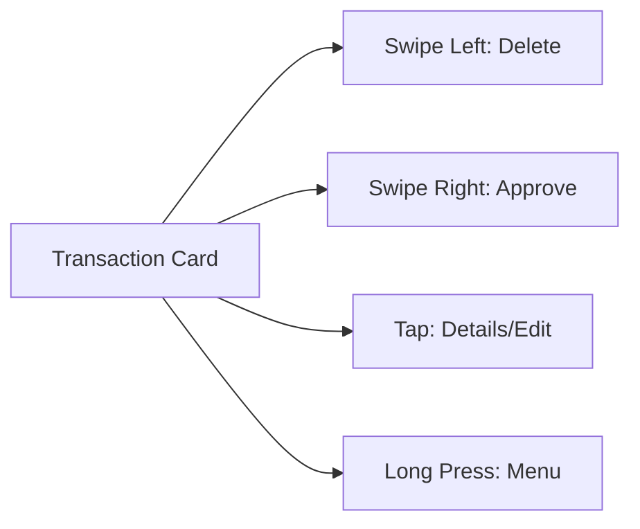
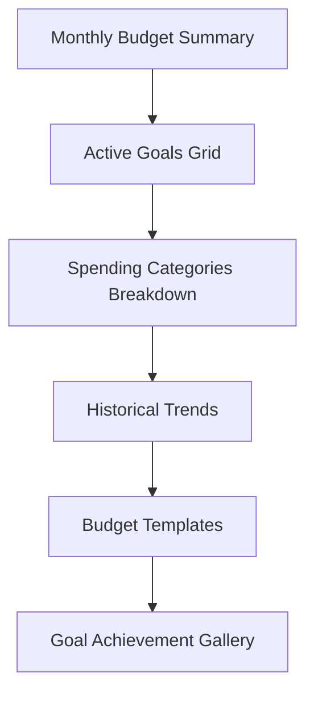
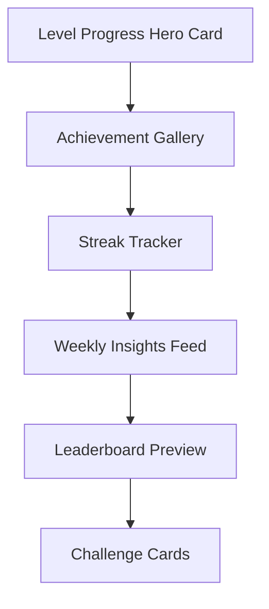
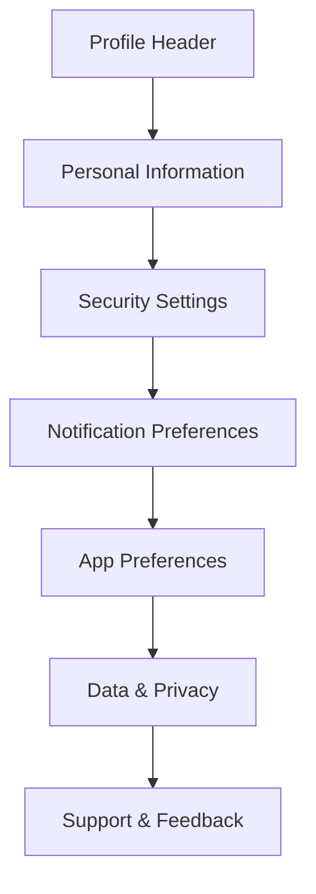
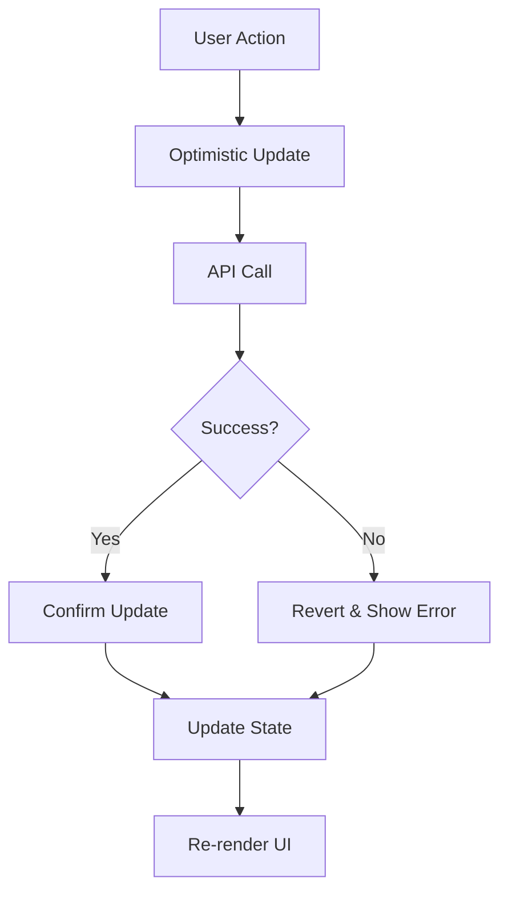
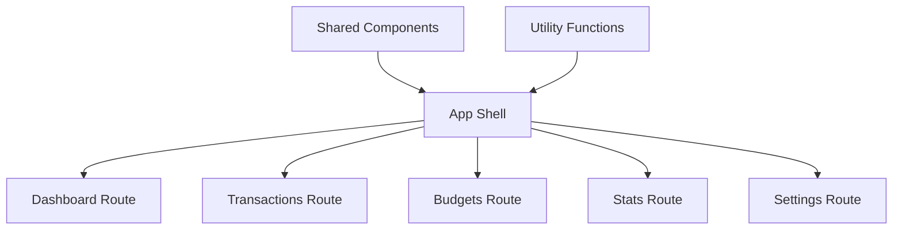

# Frontend Polish & UI Enhancement Design

## Overview

This design document outlines the comprehensive frontend polish and user experience improvements for the Budgeto MVP - a student finance app specifically designed for Greek students. The current implementation includes basic functionality with React 19, Next.js App Router, and Tailwind CSS. This polish phase will enhance the user interface, improve usability, and create a more engaging mobile-first experience.

## Technology Stack & Dependencies

### Current Implementation
- **Framework**: Next.js 19 with App Router
- **Language**: TypeScript
- **Styling**: Tailwind CSS with custom components
- **Icons**: Lucide React
- **State Management**: React Context + useState/useEffect
- **HTTP Client**: Axios with interceptors

### Additional Dependencies for Polish
```json
{
  "framer-motion": "^11.0.0",
  "react-spring": "^9.7.0", 
  "react-use-gesture": "^9.1.3",
  "react-intersection-observer": "^9.8.0",
  "react-hot-toast": "^2.4.0",
  "react-confetti": "^6.1.0",
  "@headlessui/react": "^1.7.0",
  "react-countup": "^6.4.0",
  "date-fns": "^3.0.0"
}
```

## Component Architecture

### Enhanced UI Component Library

#### 1. Core Design System Components

**Color System Enhancement**


**Typography Scale**
- Display: 32px/40px - Page titles
- Heading 1: 24px/32px - Section headers
- Heading 2: 20px/28px - Card titles
- Body Large: 16px/24px - Primary text
- Body: 14px/20px - Secondary text
- Caption: 12px/16px - Helper text

#### 2. Enhanced Navigation Components

**MobileNavigationEnhanced.tsx**
```tsx
interface NavigationItem {
  name: string;
  href: string;
  icon: LucideIcon;
  badge?: number;
  isNew?: boolean;
}

// Features:
// - Animated tab transitions
// - Badge notifications for pending items
// - Haptic feedback simulation
// - Active state animations
// - Gesture-based swipe detection
```

**TopNavigationBar.tsx**
```tsx
interface TopBarProps {
  title: string;
  subtitle?: string;
  actions?: React.ReactNode;
  showBack?: boolean;
  gradient?: boolean;
}

// Features:
// - Sticky/floating header behavior
// - Greek flag accent gradient
// - Notification bell with count
// - Profile avatar with status indicator
```

#### 3. Enhanced Dashboard Components

**MonthlyBudgetProgressEnhanced.tsx**
```tsx
interface BudgetProgressProps {
  budgets: Budget[];
  summary: Summary;
  animated?: boolean;
  showDetails?: boolean;
}

// Features:
// - Animated progress bars with spring physics
// - Color-coded budget status (safe/warning/danger/over)
// - Greek-themed encouraging messages
// - Swipe to view different budget periods
// - Confetti animation when staying within budget
```

**PendingTransactionsCardEnhanced.tsx**
```tsx
interface PendingCardProps {
  pendingCount: number;
  recentTransactions?: Transaction[];
  onQuickApprove?: (id: number) => void;
}

// Features:
// - Preview of recent pending transactions
// - Quick swipe actions (approve/decline)
// - Pulsing animation for urgent items
// - Auto-refresh with optimistic updates
```

**GamificationBannerEnhanced.tsx**
```tsx
interface GamificationProps {
  data: GamificationData;
  showLevelUp?: boolean;
  achievements?: Achievement[];
}

// Features:
// - Level progression animation
// - XP counter with counting animation
// - Achievement unlock celebrations
// - Greek mythology themed level names
// - Daily streak fire animation
```

#### 4. Transaction Management Components

**SwipeableTransactionCard.tsx**
```tsx
interface SwipeableCardProps {
  transaction: Transaction;
  onSwipeLeft: () => void;  // Delete
  onSwipeRight: () => void; // Approve
  onEdit: () => void;
  disabled?: boolean;
}

// Features:
// - Fluid swipe gestures with spring back
// - Visual feedback for swipe actions
// - Category-based color coding
// - SMS origin badge
// - Quick edit modal
```

**TransactionFilters.tsx**
```tsx
interface FilterProps {
  activeFilters: FilterState;
  onFilterChange: (filters: FilterState) => void;
  quickFilters: QuickFilter[];
}

// Features:
// - Sliding filter chips
// - Date range picker with presets
// - Category multi-select
// - Amount range slider
// - Save custom filter presets
```

**TransactionFormEnhanced.tsx**
```tsx
interface TransactionFormProps {
  mode: 'create' | 'edit';
  initialData?: Transaction;
  onSubmit: (data: TransactionCreate) => void;
  onCancel: () => void;
}

// Features:
// - Smart category suggestions
// - Greek keyboard-friendly inputs
// - Photo attachment for receipts
// - Location detection for merchant names
// - Voice note support
```

#### 5. Budget Management Components

**BudgetCardEnhanced.tsx**
```tsx
interface BudgetCardProps {
  budget: Budget;
  progress: BudgetProgress;
  onEdit: () => void;
  onDelete: () => void;
  detailed?: boolean;
}

// Features:
// - Circular progress indicators
// - Goal deadline countdown
// - Spending velocity indicators
// - Monthly comparison charts
// - Greek motivational messages
```

**GoalCreationWizard.tsx**
```tsx
interface GoalWizardProps {
  onComplete: (goal: BudgetCreate) => void;
  presets?: GoalPreset[];
}

// Features:
// - Multi-step guided creation
// - Greek destination/goal templates
// - Smart deadline suggestions
// - Progress visualization preview
// - Celebration planning integration
```

### Enhanced Screen Layouts

#### 1. Dashboard Enhancements

**Layout Structure**


**Enhanced Features**
- Pull-to-refresh functionality
- Skeleton loading states
- Progressive data loading
- Empty state illustrations with Greek themes
- Contextual quick actions
- Weather-based spending suggestions (Greek summer vs winter)

#### 2. Transaction Inbox Redesign

**Swipe Interface**


**Enhanced Features**
- Infinite scroll with virtual scrolling
- Bulk selection mode
- Smart categorization suggestions
- Merchant logo detection
- Receipt OCR integration placeholder
- Greek bank SMS pattern highlighting

#### 3. Budget Management Interface

**Budget Overview Grid**


**Enhanced Features**
- Drag-and-drop goal prioritization
- Collaborative goals with friends (preparation)
- Smart spending alerts
- Category-wise budget allocation wheel
- Achievement celebration animations

#### 4. Gamification Dashboard

**Stats Layout**


**Enhanced Features**
- 3D level progression visualization
- Achievement unlock animations with confetti
- Greek mythology themed achievements
- Social comparison (anonymous)
- Weekly challenge participation

#### 5. Settings & Profile

**Profile Management**


**Enhanced Features**
- Animated profile picture upload
- Dark mode toggle with smooth transition
- Language selection (Greek/English)
- Data export functionality
- Privacy controls dashboard

## Styling Strategy

### Enhanced Tailwind Configuration

**Custom Color Palette**
```javascript
colors: {
  primary: {
    50: '#f0f9ff',
    100: '#e0f2fe', 
    500: '#0ea5e9',
    600: '#0284c7',
    900: '#0c4a6e'
  },
  greek: {
    blue: '#004c98',
    white: '#ffffff',
    gold: '#ffd700'
  },
  budget: {
    safe: '#10b981',
    warning: '#f59e0b', 
    danger: '#ef4444',
    over: '#dc2626'
  }
}
```

**Animation System**
```javascript
animation: {
  'slide-in-bottom': 'slideInBottom 0.3s ease-out',
  'bounce-in': 'bounceIn 0.6s ease-out',
  'level-up': 'levelUp 1s ease-in-out',
  'xp-gain': 'xpGain 0.5s ease-out',
  'confetti': 'confetti 2s ease-out'
}
```

**Mobile-First Responsive Breakpoints**
```javascript
screens: {
  'xs': '375px',
  'sm': '640px', 
  'md': '768px',
  'lg': '1024px',
  'xl': '1280px'
}
```

### Component Styling Guidelines

**Card Design System**
- Elevated cards with subtle shadows
- Rounded corners (12px standard)
- Greek-inspired accent borders
- Hover/tap states with micro-interactions
- Loading states with shimmer effects

**Button Variations**
- Primary: Greek blue gradient
- Secondary: White with blue border
- Success: Green with checkmark icon
- Danger: Red with warning icon
- Ghost: Transparent with hover effects

**Form Elements**
- Floating labels with smooth transitions
- Greek-friendly input validation
- Error states with helpful messages
- Success states with check animations
- Accessibility-focused design

## State Management Architecture

### Enhanced Context Providers

**AppStateProvider.tsx**
```tsx
interface AppState {
  // UI State
  theme: 'light' | 'dark';
  language: 'en' | 'el';
  notifications: Notification[];
  
  // Data State
  user: User | null;
  dashboard: DashboardData | null;
  transactions: Transaction[];
  budgets: Budget[];
  
  // Loading States
  isLoading: Record<string, boolean>;
  errors: Record<string, string | null>;
}
```

**Features**
- Optimistic updates for better UX
- Offline state management
- Automatic data refresh
- Error boundary integration
- Performance monitoring

### Data Flow Patterns



## API Integration Layer

### Enhanced API Client

**Features**
- Request/response interceptors
- Automatic retry logic
- Offline queue management
- Request deduplication
- Progress tracking for uploads

**Error Handling**
```tsx
interface ErrorState {
  type: 'network' | 'validation' | 'server' | 'auth';
  message: string;
  retry?: () => void;
  dismiss?: () => void;
}
```

### Real-time Updates

**WebSocket Integration (Future)**
- Real-time transaction notifications
- Live budget progress updates
- Collaborative goal updates
- Achievement notifications

## Progressive Web App Features

### Enhanced PWA Capabilities

**Manifest Configuration**
```json
{
  "name": "Budgeto - Greek Student Finance",
  "short_name": "Budgeto",
  "description": "Track expenses, manage budgets, level up! 🇬🇷",
  "theme_color": "#0ea5e9",
  "background_color": "#f8fafc",
  "display": "standalone",
  "orientation": "portrait",
  "start_url": "/",
  "scope": "/",
  "icons": [
    {
      "src": "/icons/icon-192.png",
      "sizes": "192x192",
      "type": "image/png",
      "purpose": "any maskable"
    }
  ]
}
```

**Service Worker Features**
- Offline transaction creation
- Background sync for pending data
- Push notifications for budgets
- Cached API responses
- App update notifications

### Native-like Features

**Installation Prompt**
- Smart install banner
- iOS Safari install instructions
- Android installation flow
- Desktop PWA support

**Haptic Feedback**
- Transaction approval vibration
- Achievement unlock patterns
- Error state feedback
- Navigation confirmation

## Testing Strategy

### Component Testing

**Unit Tests with Jest + Testing Library**
```tsx
// Example test structure
describe('SwipeableTransactionCard', () => {
  test('should approve transaction on right swipe');
  test('should delete transaction on left swipe');
  test('should show edit modal on tap');
  test('should respect disabled state');
});
```

**Visual Regression Testing**
- Storybook integration
- Percy.io for visual diffs
- Cross-browser testing
- Mobile viewport testing

### Integration Testing

**Cypress E2E Tests**
```javascript
// Example test scenarios
describe('Transaction Flow', () => {
  it('should create transaction via SMS parsing');
  it('should approve pending transactions');
  it('should update budget progress');
  it('should award XP correctly');
});
```

### Performance Testing

**Core Web Vitals Optimization**
- Largest Contentful Paint < 2.5s
- First Input Delay < 100ms
- Cumulative Layout Shift < 0.1
- Time to Interactive < 3s on 3G

**Bundle Size Optimization**
- Tree shaking for unused code
- Dynamic imports for routes
- Image optimization
- Font loading optimization

## Accessibility & Internationalization

### Accessibility Features

**WCAG 2.1 AA Compliance**
- Semantic HTML structure
- Keyboard navigation support
- Screen reader optimizations
- High contrast mode support
- Focus management

**Mobile Accessibility**
- Large tap targets (44px minimum)
- Voice control support
- Reduced motion preferences
- Touch gesture alternatives

### Greek Localization

**Language Support**
- Complete Greek translation
- RTL text support where needed
- Cultural number formatting
- Greek keyboard shortcuts
- Local date/time formats

**Content Localization**
- Greek bank terminology
- Cultural spending categories
- Local holiday considerations
- Greek university context

## Performance Optimization

### Code Splitting Strategy



### Image Optimization

**Next.js Image Component Usage**
- WebP format with fallbacks
- Responsive image sizing
- Lazy loading by default
- Blur-up placeholders
- Priority loading for hero images

### Memory Management

**React Optimization**
- useMemo for expensive calculations
- useCallback for event handlers
- React.memo for pure components
- Virtual scrolling for large lists
- Proper cleanup in useEffect

## Security & Privacy

### Client-Side Security

**Data Protection**
- No sensitive data in localStorage
- Secure cookie settings
- XSS prevention measures
- CSP header implementation
- Input sanitization

**Privacy Features**
- Biometric authentication (future)
- Local data encryption
- Privacy-focused analytics
- GDPR compliance tools
- Data export functionality

## Deployment & Monitoring

### Build Optimization

**Next.js Configuration**
```javascript
// next.config.js
module.exports = {
  experimental: {
    appDir: true,
  },
  images: {
    domains: ['example.com'],
    formats: ['image/webp'],
  },
  compress: true,
  poweredByHeader: false,
};
```

### Performance Monitoring

**Analytics Integration**
- Core Web Vitals tracking
- User journey analysis
- Error rate monitoring
- Performance regression alerts
- A/B testing framework

### Error Tracking

**Error Boundary System**
```tsx
interface ErrorBoundaryState {
  hasError: boolean;
  error?: Error;
  errorInfo?: ErrorInfo;
}

// Features:
// - Graceful error handling
// - Error reporting to monitoring service
// - User-friendly error messages
// - Recovery action suggestions
```

## Development Workflow

### Code Quality

**ESLint + Prettier Configuration**
- TypeScript strict mode
- React hooks rules
- Accessibility linting
- Import sorting
- Consistent formatting

**Pre-commit Hooks**
- Lint staged files
- Run unit tests
- Type checking
- Bundle size checking
- Security vulnerability scanning

### Design System

**Storybook Integration**
- Component documentation
- Visual testing
- Props validation
- Usage examples
- Design token visualization

**Component Library Structure**
```
components/
├── ui/           # Basic UI components
├── layout/       # Layout components  
├── forms/        # Form components
├── data/         # Data display components
├── feedback/     # Loading, error states
└── gamification/ # Game elements
```