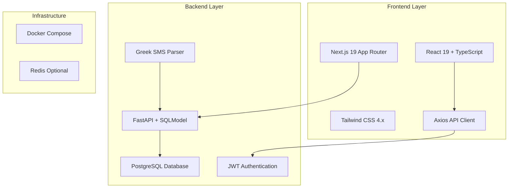
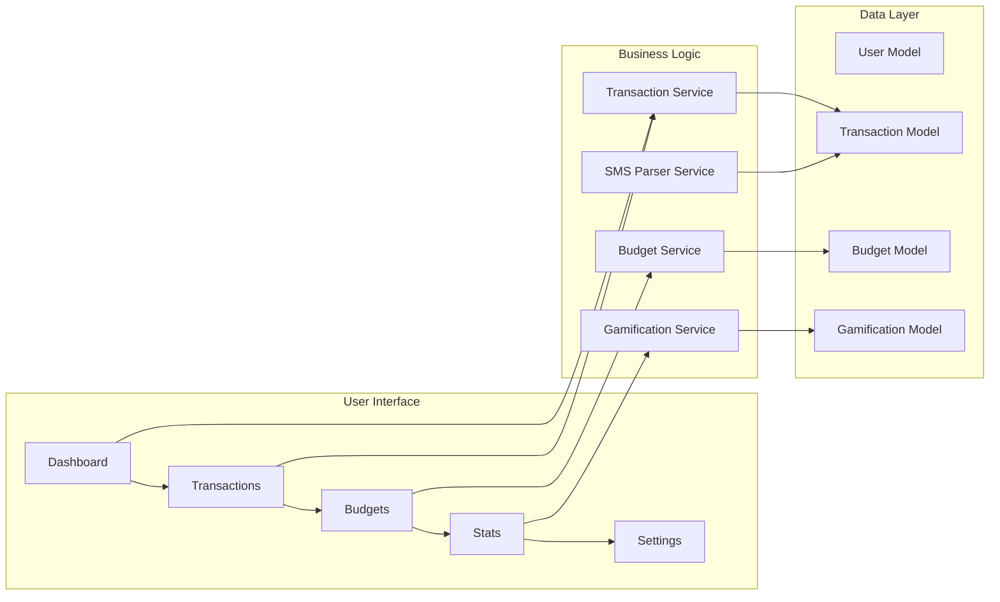
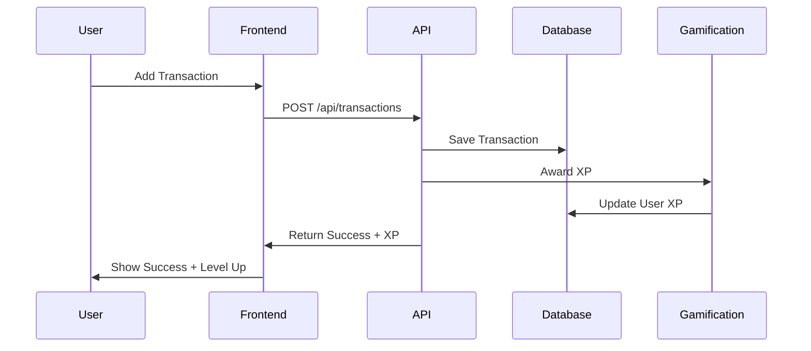

# Budgeto MVP Completion Plan

## Overview

Based on the codebase analysis, Budgeto is a **Full-Stack Application** for Greek student finance management with significant foundation already implemented. The project consists of a FastAPI backend, Next.js 19 frontend, and comprehensive SMS parsing for Greek banks.

## Current State Analysis

### ✅ Completed Components

**Backend Infrastructure (90% Complete)**
- FastAPI application with proper project structure
- Database models (User, Transaction, Budget, UserGamification) 
- SQLModel/Alembic integration
- JWT authentication system
- CORS and security configuration
- Greek SMS parser for 5 major banks (NBG, Eurobank, Alpha, Piraeus, IRIS)
- Comprehensive API endpoints structure

**Frontend Infrastructure (85% Complete)**
- Next.js 19 App Router setup
- Tailwind CSS design system with mobile-first approach
- Authentication context and routing
- API client with interceptors
- Core page structures (Dashboard, Transactions, Budgets, Stats, Settings)
- Mobile navigation component

**Features Implemented**
- User registration/login with archetype selection
- Transaction management (create, approve, delete)
- Budget creation and tracking
- Basic gamification system (XP, levels, streaks)
- SMS parsing workflow
- Mobile-responsive design foundation

### ⚠️ Issues Identified & Missing Components

**Critical Backend Gaps**
1. Missing transaction statistics summary endpoint implementation
2. Incomplete gamification XP award integration
3. Budget progress calculation not fully implemented
4. Missing user profile update endpoints
5. Incomplete weekly insights generation
6. No data validation for category suggestions

**Frontend UI/UX Polish Needed**
1. Basic UI components need enhancement (buttons, forms, cards)
2. Loading states and error handling inconsistent
3. Transaction approval workflow needs swipe interface
4. Budget progress visualization incomplete
5. Settings page functionality partially implemented
6. Missing onboarding flow completion
7. No proper empty states or data placeholders

**Missing Core Features**
1. Telegram bot integration (directory exists but empty)
2. User settings persistence
3. Transaction filtering and search
4. Budget deadline notifications
5. Weekly Greek-themed insights delivery
6. Achievement unlock notifications

## Architecture Analysis

### Technology Stack Assessment


### Component Architecture


## Completion Roadmap

### Phase 1: Backend API Completion (Priority: High)

**Task 1.1: Complete Transaction API**
- Implement `/api/transactions/stats/summary` endpoint properly
- Add transaction filtering by date range and category
- Integrate XP award system on transaction approval
- Add transaction search functionality

**Task 1.2: Enhance Budget System**
- Complete budget progress calculation with accurate spending tracking
- Implement budget deadline warnings
- Add monthly rollover logic for recurring budgets
- Create budget analytics endpoints

**Task 1.3: Gamification Integration**
- Integrate XP awards throughout transaction workflow
- Implement achievement unlock logic
- Complete weekly insights generation with Greek humor
- Add streak calculation improvements

**Task 1.4: User Management**
- Add user profile update endpoints
- Implement password change functionality
- Add account deletion with data cleanup
- User preferences storage and retrieval

### Phase 2: Frontend UI Polish & Enhancement (Priority: High)

**Task 2.1: Design System Enhancement**
```css
/* Enhanced Button System */
.btn-large { @apply px-6 py-3 text-lg; }
.btn-small { @apply px-3 py-1.5 text-sm; }
.btn-gradient { @apply bg-gradient-to-r from-primary-500 to-primary-600; }
.btn-floating { @apply fixed bottom-6 right-6 w-14 h-14 rounded-full shadow-lg; }

/* Card Variations */
.card-elevated { @apply shadow-lg border-0; }
.card-interactive { @apply hover:shadow-md transition-all cursor-pointer; }
.card-success { @apply border-l-4 border-green-500 bg-green-50; }
.card-warning { @apply border-l-4 border-yellow-500 bg-yellow-50; }

/* Progress Components */
.progress-ring { @apply relative w-20 h-20; }
.progress-linear { @apply w-full bg-gray-200 rounded-full h-2; }
```

**Task 2.2: Transaction Management Enhancement**
- Implement swipe-to-approve interface for pending transactions
- Add transaction categorization suggestions UI
- Create better transaction list with search and filters
- Add transaction editing modal with form validation

**Task 2.3: Dashboard Improvements**
```typescript
// Enhanced Dashboard Components
interface DashboardCard {
  title: string;
  value: string | number;
  subtitle?: string;
  trend?: 'up' | 'down' | 'neutral';
  icon: React.ComponentType;
  color: 'primary' | 'success' | 'warning' | 'danger';
}

// Progress Ring Component
const ProgressRing = ({ 
  progress, 
  size = 120, 
  strokeWidth = 8 
}: ProgressRingProps) => {
  const radius = (size - strokeWidth) / 2;
  const circumference = radius * 2 * Math.PI;
  const offset = circumference - (progress / 100) * circumference;
  
  return (
    <svg width={size} height={size} className="transform -rotate-90">
      <circle
        cx={size / 2}
        cy={size / 2}
        r={radius}
        stroke="currentColor"
        strokeWidth={strokeWidth}
        fill="transparent"
        className="text-gray-200"
      />
      <circle
        cx={size / 2}
        cy={size / 2}
        r={radius}
        stroke="currentColor"
        strokeWidth={strokeWidth}
        fill="transparent"
        strokeDasharray={circumference}
        strokeDashoffset={offset}
        className="text-primary-500 transition-all duration-500"
      />
    </svg>
  );
};
```

**Task 2.4: Budget Visualization**
- Create interactive budget progress circles
- Add spending category breakdown charts
- Implement budget vs actual spending comparisons
- Monthly budget history timeline

### Phase 3: Feature Completion (Priority: Medium)

**Task 3.1: Settings Implementation**
- Complete user profile editing with validation
- Implement notification preferences
- Add SMS parsing toggle settings
- Dark mode support (optional)

**Task 3.2: Gamification UI**
- Achievement unlocking animations
- Level progression celebrations
- Weekly insights with Greek-themed humor
- Streak tracking with visual feedback

**Task 3.3: Enhanced Mobile Experience**
- Pull-to-refresh functionality
- Offline state handling
- Progressive Web App (PWA) configuration
- Touch-friendly interactions

### Phase 4: Telegram Bot Integration (Priority: Low)

**Task 4.1: Bot Development**
```python
# Telegram Bot Structure
class BudgetoBot:
    def __init__(self):
        self.token = settings.TELEGRAM_BOT_TOKEN
        self.application = Application.builder().token(self.token).build()
        
    async def start(self, update: Update, context: ContextTypes.DEFAULT_TYPE):
        """Welcome message and user linking"""
        
    async def add_transaction(self, update: Update, context: ContextTypes.DEFAULT_TYPE):
        """Parse: /add Coffee 3€"""
        
    async def natural_language(self, update: Update, context: ContextTypes.DEFAULT_TYPE):
        """Parse: 'Lunch at taverna 15 euros'"""
```

**Task 4.2: Bot Commands**
- `/start` - User registration and linking
- `/add <description> <amount>` - Quick transaction entry
- `/budget` - Budget status overview
- `/stats` - Gamification progress
- Natural language parsing for transactions

## Technical Implementation Details

### Backend Enhancements

**Enhanced Transaction Model**
```python
class Transaction(SQLModel, table=True):
    # ... existing fields ...
    tags: Optional[List[str]] = Field(default=None)
    location: Optional[str] = None
    receipt_url: Optional[str] = None
    confidence_score: Optional[float] = None
    
    class Config:
        json_encoders = {
            datetime: lambda dt: dt.isoformat(),
            Decimal: lambda d: float(d)
        }
```

**Gamification Service Enhancement**
```python
class GamificationService:
    XP_MULTIPLIERS = {
        'first_week': 2.0,
        'weekend': 1.5,
        'streak_bonus': lambda streak: min(streak * 0.1, 2.0)
    }
    
    async def award_xp(self, user_id: int, action: str, multiplier: float = 1.0):
        """Award XP with streak and timing bonuses"""
        
    async def check_achievements(self, user_id: int):
        """Check and unlock new achievements"""
        
    async def generate_weekly_insights(self, user_id: int) -> List[WeeklyInsight]:
        """Generate Greek-themed weekly spending insights"""
```

### Frontend Component Library

**Enhanced Form Components**
```typescript
// Form Input with validation
const FormInput = ({ 
  label, 
  error, 
  icon: Icon,
  ...props 
}: FormInputProps) => (
  <div className="space-y-1">
    <label className="form-label">{label}</label>
    <div className="relative">
      {Icon && <Icon className="absolute left-3 top-3 h-4 w-4 text-gray-400" />}
      <input 
        className={`form-input ${Icon ? 'pl-10' : ''} ${error ? 'border-red-500' : ''}`}
        {...props} 
      />
    </div>
    {error && <p className="text-sm text-red-600">{error}</p>}
  </div>
);

// Loading States
const TransactionSkeleton = () => (
  <div className="animate-pulse space-y-3">
    {[...Array(5)].map((_, i) => (
      <div key={i} className="flex items-center space-x-3">
        <div className="h-10 w-10 bg-gray-200 rounded-full" />
        <div className="flex-1 space-y-2">
          <div className="h-4 bg-gray-200 rounded w-3/4" />
          <div className="h-3 bg-gray-200 rounded w-1/2" />
        </div>
        <div className="h-6 bg-gray-200 rounded w-16" />
      </div>
    ))}
  </div>
);
```

### Data Flow Architecture



### Testing Strategy

**Backend Testing**
```python
def test_greek_sms_parsing():
    """Test SMS parsing for all supported banks"""
    test_cases = [
        ("NBG: Αγορά 45.30 EUR στο SUPERMARKET ABC", 45.30, "EXPENSE"),
        ("Eurobank: Πίστωση 200.00 EUR - Μισθός", 200.00, "INCOME"),
    ]
    
def test_gamification_xp_calculation():
    """Test XP calculation with bonuses"""
    
def test_budget_progress_accuracy():
    """Test budget calculation precision"""
```

**Frontend Testing**
```typescript
describe('Transaction Approval Workflow', () => {
  test('swipe right approves transaction', async () => {
    // Test swipe gesture handling
  });
  
  test('shows XP award notification', async () => {
    // Test gamification feedback
  });
});
```

## Performance Optimizations

### Backend Optimization
- Database query optimization with proper indexing
- Redis caching for frequently accessed data
- Background tasks for XP calculations
- SMS parsing result caching

### Frontend Optimization
- Image optimization for better mobile performance
- Code splitting by route
- Service worker for offline functionality
- Lazy loading for non-critical components

## Security Enhancements

**Authentication Security**
- Rate limiting on login attempts
- JWT token rotation
- Session management improvements
- Password strength validation

**Data Protection**
- Input sanitization for SMS content
- XSS protection in dynamic content
- CSRF token implementation
- Encrypted sensitive data storage

## Deployment Preparation

**Production Configuration**
```yaml
# docker-compose.prod.yml
services:
  nginx:
    image: nginx:alpine
    ports: ["80:80", "443:443"]
    depends_on: [frontend, backend]
    
  backend:
    environment:
      - DATABASE_URL=${DATABASE_URL}
      - JWT_SECRET=${JWT_SECRET}
      - ENVIRONMENT=production
      
  frontend:
    environment:
      - NEXT_PUBLIC_API_URL=${API_URL}
      - NODE_ENV=production
```

**Monitoring Setup**
- Health check endpoints
- Performance monitoring
- Error tracking integration
- User analytics setup

## Timeline Estimation

**Week 1-2: Backend Completion**
- Transaction API enhancement (3 days)
- Budget system completion (2 days) 
- Gamification integration (2 days)
- User management APIs (1 day)

**Week 3-4: Frontend Polish**
- Design system enhancement (3 days)
- Transaction UI improvements (2 days)
- Dashboard visualization (2 days)
- Settings implementation (1 day)

**Week 5: Feature Integration**
- Telegram bot development (3 days)
- Testing and bug fixes (2 days)

**Week 6: Polish & Deploy**
- Performance optimization (2 days)
- Security hardening (1 day)
- Production deployment (2 days)

## Success Metrics

**Technical Metrics**
- API response time < 200ms average
- Frontend load time < 3 seconds on 3G
- 99.5% uptime
- Zero critical security vulnerabilities

**User Experience Metrics**
- Transaction approval rate > 85%
- User retention > 70% weekly
- SMS parsing accuracy > 90%
- Mobile usability score > 90

## Risk Mitigation

**Technical Risks**
- Database migration issues → Comprehensive backup strategy
- SMS parsing accuracy → Fallback manual entry
- Performance bottlenecks → Progressive enhancement approach

**User Experience Risks**
- Complex onboarding → Guided tutorial implementation  
- Greek language barriers → Localization testing
- Mobile performance → Device testing matrix

This comprehensive plan addresses the current gaps while building upon the solid foundation already implemented, ensuring a polished and production-ready MVP within 6 weeks.