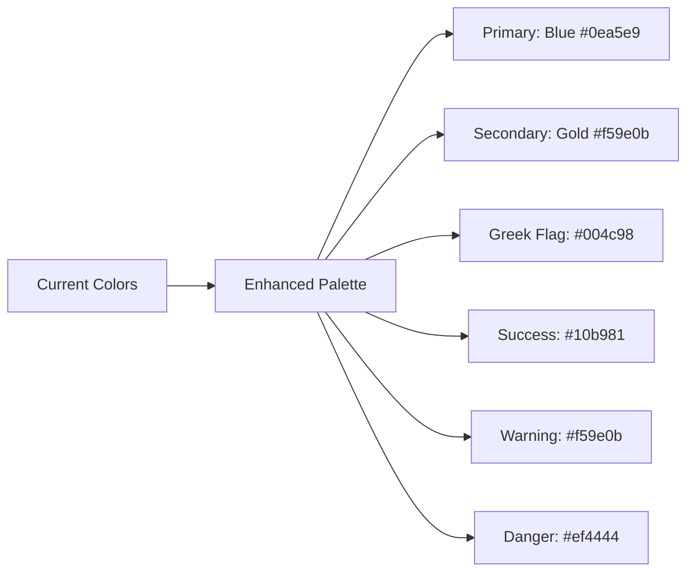

# Frontend Polish Design Document
**Budgeto MVP - UI/UX Enhancement & Finalization**

## Overview

Based on the current MVP implementation analysis, Budgeto has achieved functional completeness with a solid foundation. This design document outlines comprehensive frontend polish strategies to transform the functional MVP into a delightful, market-ready student finance application for the Greek market.

## Current MVP State Assessment

### ✅ Implemented Features
- **Authentication System**: Complete login/register flow with JWT
- **Dashboard**: Real-time financial overview with balance, progress tracking
- **Transaction Management**: Full CRUD with SMS parsing, pending approval workflow
- **Budget System**: Monthly budgets and savings goals with progress tracking
- **Gamification**: XP system, levels, streaks, and Greek-themed achievements
- **Settings**: Profile management with comprehensive preferences
- **Mobile Navigation**: Bottom tab navigation optimized for mobile-first design
- **Backend Integration**: Complete API integration with proper error handling

### 🎯 Polish Opportunities Identified
1. **Visual Design Refinement**: Enhance aesthetics and brand identity
2. **Micro-interactions**: Add delightful animations and feedback
3. **Cultural Localization**: Strengthen Greek market appeal
4. **Performance Optimization**: Improve loading states and transitions
5. **Accessibility Enhancement**: Ensure inclusive design patterns
6. **Mobile Experience**: Perfect touch interactions and responsive behavior

## Design System Enhancement

### Color Palette Refinement


**Enhanced Color Applications:**
- **Primary Blue (#0ea5e9)**: Main actions, navigation, progress bars
- **Greek Blue (#004c98)**: Headers, premium features, cultural elements
- **Gold (#f59e0b)**: Achievements, rewards, level indicators
- **Semantic Colors**: Consistent budget status and transaction type indicators

### Typography Enhancement
- **Primary Font**: Inter (current) - excellent readability on mobile
- **Font Weights**: 400 (regular), 500 (medium), 600 (semibold), 700 (bold)
- **Scale**: Consistent type scale for better hierarchy
- **Greek Text Support**: Ensure proper rendering of Greek characters

### Iconography Strategy
- **Current**: Lucide React icons (excellent choice)
- **Enhancement**: Custom Greek-themed icons for cultural elements
- **Consistency**: Standardized icon sizes (16px, 20px, 24px)
- **Semantic Icons**: Consistent category and action representations

## Component Architecture Enhancement

### Enhanced Dashboard Components

#### MonthlyBudgetProgress Component
```jsx
// Enhanced with micro-interactions and better visual hierarchy
<MonthlyBudgetProgress>
  + Animated progress bars with easing
  + Contextual color changes based on spending
  + Greek-inspired visual elements (olive branch patterns)
  + Haptic feedback on mobile interactions
  + Smart spending insights ("You're on track like Athena!")
</MonthlyBudgetProgress>
```

#### PendingTransactionsCard Component
```jsx
// Enhanced with swipe gestures and visual feedback
<PendingTransactionsCard>
  + Swipe-to-approve animations
  + Visual feedback for user actions
  + Batch approval capabilities
  + Smart categorization suggestions
  + SMS source indicators with bank logos
</PendingTransactionsCard>
```

#### LevelStreakBanner Component
```jsx
// Enhanced gamification with Greek mythology themes
<LevelStreakBanner>
  + Particle effects for level progression
  + Greek mythology level titles
  + Animated XP bar with sound effects
  + Achievement unlock celebrations
  + Social sharing capabilities
</LevelStreakBanner>
```

### Transaction Management Enhancement

#### Swipeable Transaction Cards
```jsx
// Enhanced interaction patterns
<SwipeableTransaction>
  + Smooth swipe animations (approve right, delete left)
  + Visual feedback during swipe
  + Undo functionality with toast notifications
  + Category quick-edit with dropdown
  + Amount quick-edit with number pad
  + Bulk selection for batch operations
</SwipeableTransaction>
```

#### Smart Categorization UI
```jsx
// AI-powered suggestions with confidence indicators
<CategorySuggestion>
  + Confidence percentage display
  + One-tap approval/override
  + Learning feedback loop
  + Custom category creation
  + Greek merchant name recognition
</CategorySuggestion>
```


